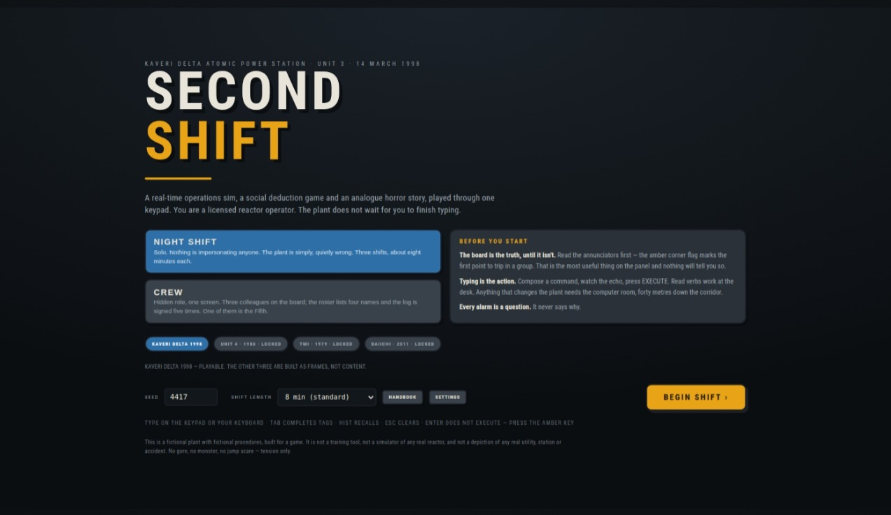
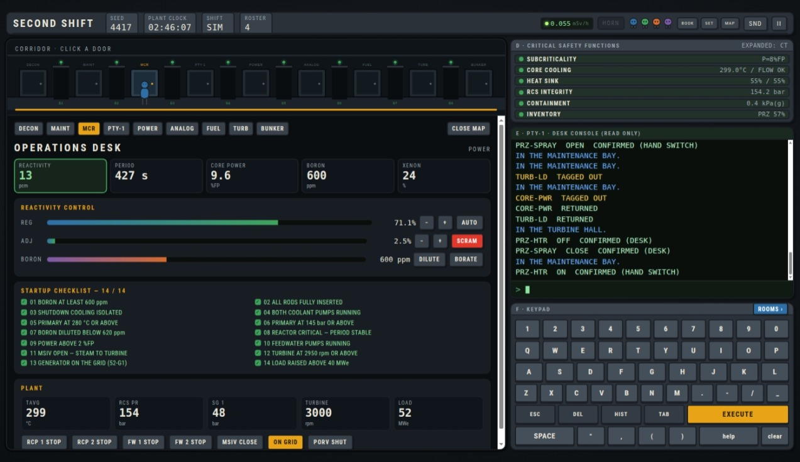

# SECOND SHIFT

**A real-time nuclear operations simulator, a social deduction game and an analogue horror story, played through one keypad.**

You are a licensed reactor operator on the night shift at a fictional coastal nuclear station. Every consequential action passes through a keypad: you type `sw FW-2P OPEN`, watch the echo, and press EXECUTE.

[](Second_Shift.html)
[](Second_Shift.html)
[](README.md)
[](LICENSE)

Everything ships as **one self-contained HTML file** — no build step, no dependencies, no network access. Open it and play.

## Screenshots

<p align="center">
  
  
</p>

```text
Second_Shift.html      ← the whole game, 272 KB
```

---

## Quick start

1. Download `Second_Shift.html`.
2. Open it in a modern browser (Chrome, Firefox, Safari, Edge).
3. Pick a mode and press **BEGIN SHIFT**.

No server, no install, no internet connection required after download. It runs from a USB stick.

---

## The four modes

| Mode | Players | What it asks |
|---|---|---|
| **SIMULATOR** | 1 | Run the plant. Hot standby to full power, or a channel-type RBMK with a margin problem. No timer, no antagonist. |
| **NIGHT SHIFT** | 1 | Three shifts on the same plant while the building is quietly wrong. The horror director runs here and nowhere else. |
| **CREW** | 2–4, one screen | Find the fifth name on the log before the shift review. The plant is a shared alibi. |
| **STORY** | 1 | Four historical accidents, rebuilt and playable. |

---

## Two reactors

The simulator models two machines that fail in opposite directions.

**Kaveri Delta Unit 3** — 540 MWe pressurised heavy water reactor. Subcooled coolant at 155 bar, boron shim, two regulating rod banks, on-power refuelling through 306 channels. Stable at power, punishing at the limits.

**Unit 4** — channel-type RBMK, graphite moderated, boiling light water. 211 individually drivable control rods among 1661 channels, a strongly positive void coefficient, and an operational reactivity margin that can vanish in a single bad decision.

---

## What is actually modelled

- **Six-group point kinetics** with standard U-235 delayed neutron data, prompt-jump approximation and implicit precursors. The period on the desk is the period the inhour equation gives.
- **A reactivity balance in pcm**: rod worth curves, chemical shim at 7 pcm/ppm, xenon-135 at 2200–2600 pcm, Doppler on fuel, moderator and graphite feedback, and a void term.
- **Xenon and iodine** with their own build-up and burnout, time-compressed so one real minute is one plant hour. A shutdown buys you a poison outage.
- **Decay heat** in two groups — 6.5 % at scram, falling slowly. Why the pumps matter more than the rods after a trip.
- **A primary energy balance** against saturation curves, steam generators or drum separators, a turbine that accelerates on pressure and locks to the grid, and a DC bus with real sources and loads.
- **RBMK rod worth with graphite displacers** — the first 18 % of insertion adds reactivity before it removes it. Pressing AZ-5 on a core with the rods out produces a power excursion before the shutdown signal is even processed.
- **Fuel damage** from sustained overpower or over-temperature, which feeds back into containment dose and into the survey meter.

---

## The board

Six fixed regions, 1600 × 900 logical stage, letterboxed:

| Region | Contents |
|---|---|
| **A** Annunciator | 12 × 5 tiles, two pages, 120 live points |
| **B** Instruments | Six meters, a four-trace recorder, a dot-matrix printer |
| **C** Mimic | Reactor, separators, turbine, generator, grid |
| **D** SPDS | Six safety functions, plus the reactivity margin on the RBMK |
| **E** Shell | Scrollback, echo line, cursor |
| **F** Keypad | 47 keys plus ESC, DEL, HIST, TAB and the amber EXECUTE |

The annunciator has five states — NORMAL, ALARM, ACKED, CLEARED and the invisible SUPPRESSED — with flood suppression, first-out flags, ringback and priority-based alarm tones.

---

## The station

Nine rooms along one corridor, eight blast doors that visibly drop:

Change room · Maintenance bay · Main control room · Computer room · Emergency power room · Analogue annex · Refuelling bay · Turbine hall · Escape bunker

- **Three consoles.** The desk is read-only. The computer room is read and write, forty metres away. The backup console in the power room does switches and setpoints only.
- **Blast doors** with caution lamps — green open, amber blinking while moving, red shut. A closed door stops you walking through it.
- **The computer room can become too hot to enter.** Past 1 mSv/h on the door monitor the full console is gone, and what is left is the backup console and the analogue annex.
- **A survey meter** in the header whose geiger click rate is the actual dose rate where you are standing.

---

## Story mode

Four chapters, each turning on a mechanism the simulator already had:

| Chapter | Year | The mechanism |
|---|---|---|
| **SL-1** | 1961 | Rod worth and prompt criticality |
| **Three Mile Island** | 1979 | A stuck PORV and a level instrument measuring the wrong vessel |
| **Fukushima Daiichi** | 2011 | Station blackout, draining batteries, decay heat |
| **Chernobyl Unit 4** | 1986 | Positive scram, void coefficient, a margin below its limit |

Each opens with the briefing the shift actually had, runs an objective bar, and ends with a card stating what happened in the real event and how your run differed.

---

## Controls

| Input | Action |
|---|---|
| Keyboard or on-screen keypad | Type a command |
| `TAB` | Complete a tag if the prefix is unambiguous |
| `HIST` / up arrow | Recall the previous command |
| `ESC` | Clear the buffer |
| `DEL` / backspace | Backspace |
| **EXECUTE** | Commit the command (ENTER does nothing by default) |
| `F1` | Quick reference handbook |
| Click a tile | Acknowledge the alarm |
| Click a meter | Assign it to a recorder trace |

---

## Settings

- **View mode** — Auto, Desktop, Responsive, Mobile. Auto picks mobile under 880 px, responsive under 1360 px, and the fixed board above.
- **Text size** — 90 % to 150 %, with tile captions and key labels capped so the matrix keeps its shape.
- **Plant time** — ×1, ×3 or ×8. A real heat-up is a real heat-up; ×8 turns a cold start into ten minutes.
- **Geiger counter** — its own toggle, separate from the master sound switch.
- **Reduce flashing** and **Enter executes**.

Settings persist on the device.

---

## Technical notes

- One HTML document: a single `<style>` and a single `<script>`. No framework, no bundler, no assets.
- Art is inline SVG and canvas; audio is synthesised at runtime with WebAudio — there are no audio files in the build.
- The simulation runs at a fixed 10 Hz with a seeded RNG. The same seed and the same command stream produce the same plant.
- Plant time is a multiplier on the physics, not on the tick.
- ~272 KB uncompressed.

---

## What is *not* modelled

Stated plainly, because the failure mode of this game is being mistaken for a training tool:

- **The core is lumped, not spatial.** No axial flux tilt, no 3D neutron diffusion, no channel-by-channel thermal hydraulics. Chernobyl reproduces in kind, not in magnitude.
- **The numbers are tuned.** The couplings are physically consistent, but they are tuned for a browser and a session — not licensed from a design basis.
- **There is no multiplayer.** CREW is played on one screen with simulated colleagues.
- **Windscale and Tokaimura are not in the build.** A graphite fire and an unmoderated criticality would each need a model this engine does not have.

---

## Disclaimer

SECOND SHIFT is a fictional plant with fictional procedures, built as a game. It is **not** a training tool, **not** a simulator of any real reactor, and **not** a depiction of any real utility or station.

Rated T — tension and dread, no gore.

---

## Licence

Source and design © Soumyajit Roy, 2026. Concept and design by Soumyajit Roy. GNU GPLv3 Made with Sarvam.
